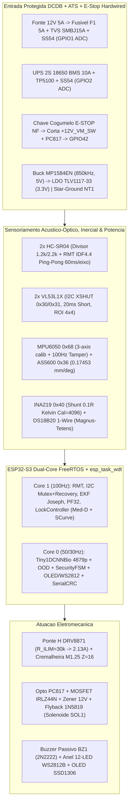

# Arquitetura Técnica do Sistema AEGIS-MECH S3 (`v3.0`)

O **AEGIS-MECH S3** é uma plataforma mecatrônica de alta segurança e controle autônomo com Inteligência Artificial multimodal embarcada em microcontrolador **ESP32-S3-WROOM-1-N16R8** (Dual Xtensa LX7 @ 240 MHz + SIMD PIE, `16 MB` Flash Quad SPI + `8 MB` Octal PSRAM — modo `qio_opi`).

Consulte a especificação integral em [Plano de desenvolvimento.md](../../Plano%20de%20desenvolvimento.md).

---

## 1. Topologia de Hardware e Sensoriamento Redundante

---

## 2. Pipeline de Controle, Fusão e TinyML Bit-Exact

1. **Fusão Sensorial Bayesiana:** EKF 2D na **Forma de Joseph** com gating de Mahalanobis ($d_M^2 \le 6{,}63$), Filtro de Partículas com `xorshift32` + reamostragem sistemática ($N_{\text{eff}} < 16$), e compensação acústica termohigrométrica **Magnus-Tetens** $c(T, RH)$.
2. **Controle Híbrido Verificado Espectralmente:** Perfil quíntico C² `SCurveProfile`, controlador Fuzzy-PID `3×3` com **derivada exclusivamente na medição** (zero *derivative kick*), anti-windup *back-calculation*, feedforward `ActuatorNetMLP` calibrada em `data/actuator_logs/actuator_logs.csv`, guarda temporal `MAX_AGE = 150 ms` e estabilidade discreta validada por **Faddeev-LeVerrier + Durand-Kerner** (`python/aegis_ai/control_stability.py`).
3. **TinyML Bit-Exact:** `Tiny1DCNNBio` (`4.879` parâmetros após folding BN→Conv1d / `5.023` pré-fold), quantização simétrica estrita `[-127, +127]`, perda biométrica `SupCon` cosseno com `GroupKFold`, POST real no boot verificando **`20/20` vetores dourados** (`max |Δ logits| == 0`).

---

## 3. Referências Cruzadas
- [Protocolo Binário AEGIS-PROTO v1](protocolo_comunicacao.md)
- [Simuladores 3D Web & Bancadas (`Learn Arduino 3D`, `Xplora3D`, `Wokwi`)](simuladores_3d_web.md)
- [Plano de Testes e Matriz V&V](plano_de_testes.md)
- [Integração dos 20 Repositórios](INTEGRACAO_REPOSITORIOS.md)
